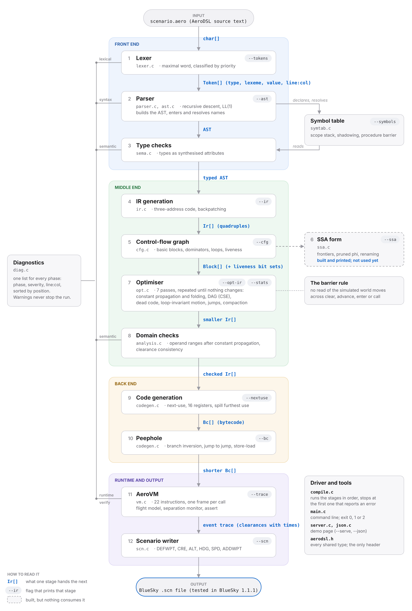

# AeroDSL

A language for air-traffic-control training scenarios, and a compiler for it.

**Compiler Design (BCSE307L) · course project**

| Team member | Registration number |
|---|---|
| Kaustav Goel | 24BCE0426 |
| Jaskaran Singh | 24BCE0466 |

**Slides:** [Review 1: the problem](slides/AeroDSL_Review1.pptx) ·
[Review 2: design and architecture](slides/AeroDSL_Review2_Design_Architecture.pptx) ·
[Review 3: implementation and results](slides/AeroDSL_Review3_Implementation_Results.pptx).
[`docs/SLIDES.md`](docs/SLIDES.md) gives the command that reproduces every slide.

> **Scope.** This is an academic prototype built for a Compiler Design course
> project. It generates and checks scenario files for ATC *simulators*. It is
> not connected to, and must not be connected to, real aircraft, live ATC
> infrastructure, or any safety-critical system. Its flight model, its
> separation standard and its waypoint data are deliberate simplifications
> chosen for teaching. Nothing here has been reviewed by anyone with air
> traffic control expertise.

---

## Get the code

Either download it (on this page: **Code**, then **Download ZIP**, then unzip),
or clone it:

```sh
git clone https://github.com/Jaskaran-Singh-ops/AeroDSL.git
cd AeroDSL
```

## Run it now (nothing to install)

Ready-to-run programs are in `bin/`. Open a terminal in the `AeroDSL` folder.

**Windows** (Command Prompt; in PowerShell type `.\aerodsl` instead of `aerodsl`):

```bat
aerodsl examples\13_walkthrough.aero
aerodsl --trace examples\02_converging.aero
aerodsl --phases examples\13_walkthrough.aero
aerodsl examples\14_review_errors.aero
```

These print the scenario file, what happened second by second, every compiler
phase, and the errors for a program the compiler rejects. `aerodsl --help`
lists every option. To save a scenario file:
`aerodsl examples\13_walkthrough.aero > walkthrough.scn`.

Double-click `run-demo.bat` to open the phase-by-phase demonstration page in
your browser. Close the "AeroDSL server" window to stop it.

**macOS and Linux:**

```sh
bin/macos-arm64/aerodsl examples/13_walkthrough.aero   # Mac with Apple silicon (M1 and later)
bin/macos-x64/aerodsl   examples/13_walkthrough.aero   # Intel Mac
bin/linux-x64/aerodsl   examples/13_walkthrough.aero   # Linux (arm64: bin/linux-arm64)
./run-demo.sh                                          # the demonstration page
```

**First-run warnings.** The programs are not signed by a registered publisher,
so the operating system may stop them the first time:

- Windows SmartScreen: choose **More info**, then **Run anyway**.
- macOS: run `xattr -d com.apple.quarantine bin/macos-*/aerodsl` once.
- If unzipping lost the executable bit: `chmod +x bin/*/aerodsl run-demo.sh`.

**How the prebuilt programs were checked.** The Windows and Linux x64 programs
were run on all 17 examples with each of the 15 phase options, and their
output, diagnostics and exit status matched the reference build in all 255
runs (Windows under Wine; `sh tools/check_release.sh` repeats the check). The 336-check test suite also passes as a Windows
program, and the demonstration server was tested on both. The macOS and
Linux arm64 programs come from the same sources and toolchain but have not
been run, because no such machine was available. If one misbehaves, build
from source with `make`.

---

## What it is

An ATC training scenario is a scripted traffic situation: aircraft with
starting positions, and a timeline of clearances issued to them. Simulators
read these from files that are flat lists of timestamped commands:

```
00:00:00.00>CRE AI202,A320,12.95,77.67,45,FL320,280
00:01:30.00>ALT AI202,FL320
00:03:00.00>HDG AI202,270
```

That format is easy for a simulator to read and unpleasant for a person to
write. It has no variables, so a value used ten times is typed ten times. It
has no conditionals, so "turn when this aircraft reaches FL300" has to be
converted by hand into an absolute timestamp, and silently becomes wrong when
the starting altitude is edited. Nothing checks it: a heading of 450 degrees, a
command naming an aircraft that was never created, two clearances that
contradict each other — all are discovered by running the simulator and
watching. And the author's *intent* — that these two aircraft must converge, or
must not — is nowhere in the file.

AeroDSL is a small language in which the scenario is a program, and a compiler
that turns it into that flat file:

```
scenario "Converging pair at FL320"

fix VOMAN 12.95 77.67
fix AKTIV 13.20 77.90

let level = FL320

flight AI202 type A320 enter VOMAN alt level hdg 045 spd 280KT
flight BA117 type B777 enter AKTIV alt level hdg 225 spd 300KT

# Track the closest the pair ever comes, in the language itself.
let closest = 500
let elapsed = 0
while elapsed < 600 do
  advance 10
  closest = min(closest, hsep(AI202, BA117))
  elapsed = elapsed + 10
end

print "closest approach: ", closest, " NM"

# The scenario's whole purpose, stated as a checkable claim.
assert closest < 5, "the pair must come within 5 NM, or there is no exercise"
```

The compiler type-checks it, range-checks the operands, warns about clearances
that contradict each other, simulates it, verifies the `assert`, and writes the
flat scenario file.

`docs/SPEC.md` sections 1.2 to 1.4 set out the problem and the honest limits of
the claim, including why a Python library would be a reasonable alternative and
what a language gives you that it does not.

---

## Building and running

Nothing but a C compiler and `make`. No libraries, no generators, no
frameworks. It builds on Linux and macOS with `make`; `make release` rebuilds
the programs in `bin/` for every system from one machine (it needs Zig's C
cross-compiler: `pip install ziglang`). Only `src/port.c` and the
demonstration server know which system they are on.

```sh
make                      # builds ./aerodsl
make test                 # 336 unit and integration checks, plus the examples
make ui                   # the phase-by-phase demonstration on :8080
```

```sh
./aerodsl examples/02_converging.aero            # scenario file to stdout
./aerodsl --trace examples/02_converging.aero    # what happened, second by second
./aerodsl --phases examples/02_converging.aero   # every phase of the pipeline
./aerodsl --ir --opt-ir --stats examples/06_optimise.aero   # before and after
./aerodsl --help
```

Diagnostics go to standard error and the scenario file to standard output, so
`./aerodsl in.aero > out.scn` works. The exit status is 0 on success — warnings
alone do not change it — 1 if an error was reported, and 2 if the input could
not be read.

---

## The pipeline

<p align="center">
  <picture>
    <source media="(prefers-color-scheme: dark)" srcset="docs/img/architecture-dark.png">
    
  </picture>
</p>

The same pipeline as text:

```
   source  ──▶ lexer ──▶ parser ──▶ AST ──▶ semantic analysis
                                               │
                                               ▼
   scenario file ◀── AeroVM ◀── bytecode ◀── code generation
         ▲                                     ▲
         │                                     │
     verification                      optimiser ◀── CFG ◀── three-address code
```

| Phase | Source | What it does |
|---|---|---|
| Lexical analysis | `src/lexer.c` | Hand-written scanner, typed tokens with positions |
| Syntax analysis | `src/parser.c` | Recursive descent, one function per production |
| Symbol table | `src/symtab.c` | Scope stack, shadowing, declaration sites |
| Semantic analysis | `src/sema.c` | Types, arity, scope rules, code-quality warnings |
| Intermediate code | `src/ir.c` | Three-address code, short-circuit backpatching |
| Control-flow graph | `src/cfg.c` | Basic blocks, dominators, natural loops, liveness |
| SSA | `src/ssa.c` | Dominance frontiers, pruned phi placement, renaming |
| Optimisation | `src/opt.c` | Seven passes, run to a fixed point |
| Domain analysis | `src/analysis.c` | Operand ranges and clearance consistency |
| Code generation | `src/codegen.c` | Next-use, register allocation, bytecode, peephole |
| Execution | `src/vm.c` | Register VM, flight model, separation monitor |
| Output | `src/scn.c` | The flat timestamped command list |

`docs/ARCHITECTURE.md` describes each stage: its inputs and outputs, its data
structures, its algorithms and how it handles errors.

---

## What is in this repository

```
AeroDSL/
├─ src/        the compiler: 20 C files and one header (aerodsl.h)
├─ examples/   17 example programs; 7 of them are written to fail
├─ tests/      the 336-check test suite, the example checks and the fuzzer
├─ bin/        ready-to-run programs for Windows, macOS and Linux
├─ ui/         the phase-by-phase demonstration page
├─ bluesky/    the BlueSky side of the comparison, and a script to replay it
├─ docs/       specification, architecture, viva questions, slide commands
├─ slides/     the Review 1, Review 2 and Review 3 presentations
├─ tools/      release build and check scripts, and the Review 1 deck source
├─ Makefile    make, make test, make ui, make fuzz, make release
└─ README.md   this file
```

---

## Documentation

| File | What is in it |
|---|---|
| `docs/SPEC.md` | The language: motivation, grammar, types, semantics, limits |
| `docs/ARCHITECTURE.md` | The compiler: every stage, with the algorithms |
| `docs/SYLLABUS.md` | Each syllabus module mapped to the code that implements it |
| `docs/VIVA.md` | 40 questions with answers, including the awkward ones |
| `docs/DEMO.md` | A five-minute talk and a ten-minute live demonstration |
| `docs/STATUS.md` | What works, what does not, known bugs, what is next |
| `docs/SLIDES.md` | For every slide of the Review 2 and Review 3 decks, the command that reproduces it |
| `docs/REVIEW.md` | Project review: audit, scope tiers, problem statement with evidence tiers, syllabus mapping, build evidence, remaining weaknesses |
| `docs/SPEAKER_NOTES.md` | Presentation scripts (5 and 10 minute), full compiler walkthrough, 26 viva questions, claims to avoid |
| `slides/` | The three review presentations: Review 1 (the problem, 20 slides), Review 2 (design and architecture, 17 slides), Review 3 (implementation and results, 19 slides) |

---

## The examples

```sh
ls examples/
```

| File | What it shows |
|---|---|
| `01_minimal.aero` | the smallest complete scenario |
| `02_converging.aero` | a deliberate conflict, verified by `assert` |
| `03_procedures.aero` | one arrival profile applied to three aircraft |
| `04_conditional.aero` | a clearance that depends on simulated state |
| `05_loop.aero` | waiting for a level instead of guessing a timestamp |
| `06_optimise.aero` | every optimisation pass firing |
| `07_lexical_errors.aero` | every lexical error |
| `08_syntax_errors.aero` | error recovery reporting six mistakes at once |
| `09_type_errors.aero` | the type and name errors |
| `10_domain_errors.aero` | range violations and contradictory clearances |
| `11_boundaries.aero` | values exactly on every range boundary |
| `12_separation.aero` | the conflict resolved, and that verified too |
| `13_walkthrough.aero` | the line followed through every phase in the review slides |
| `14_review_errors.aero` | a range error hidden in a variable, and contradictory clearances |
| `15_longer_hold.aero` | example 3 with one hold made longer: ten timed lines move |
| `16_four_mistakes.aero` | the four mistakes from the BlueSky comparison |
| `17_scope.aero` | a procedure that cannot see main's variable |

Files 07 to 10, 14, 16 and 17 are meant to fail; the test suite checks that
each one does.

`bluesky/` holds the BlueSky side of the comparison: the hand-written file with
four mistakes, the scenario files the compiler generates for examples 3, 5 and
15, and `run_bluesky.py`, which replays any of them in BlueSky 1.1.1 headless.
`docs/SLIDES.md` lists, for every slide in the review deck, the command that
reproduces it.

---

## Testing

```sh
make test
```

336 checks over every phase. Three of them matter more than the rest:

- a **differential test** that runs eighteen scenarios twice, with and without
  the optimiser, and requires the observable behaviour to be identical. This is
  what catches an unsound optimisation, and in particular a pass that moves a
  read of the simulated world across an `advance`;
- a **register-pressure test** with twenty simultaneously live values and
  sixteen registers, checking the arithmetic result against a figure computed by
  hand, so the spill and reload paths are exercised rather than merely compiled;
- a **recursion test**, so more than one activation record is live at a time.

Two further checks are in the tree rather than described second-hand:

```sh
make debug      # the same sources with AddressSanitizer and UBSan
make fuzz       # 3000 fuzz inputs against that sanitiser build
```

`make fuzz` runs `tests/fuzz.py`, which feeds the compiler random token
sequences, random bytes, and valid examples with a few random byte edits, and
fails on any exit status that is not 0, 1 or 2. At the time of writing the
whole test suite runs clean under both sanitisers and 3000 fuzz inputs produce
no crash; the point of shipping the harness is that you can check that rather
than take my word for it.

---

## Honesty about what this is

The compiler is complete in the sense that every phase is implemented and the
whole pipeline runs end to end. It is a prototype in the sense that its
register allocator is local to a basic block, its common-subexpression
elimination does not cross blocks, its SSA form is built for inspection rather
than used by the optimiser, and its flight model is a kinematic approximation
with fixed rates. `docs/SPEC.md` section 14 lists twenty-two specific
limitations and `docs/STATUS.md` says which parts are finished, which are
partial and which were not attempted.
